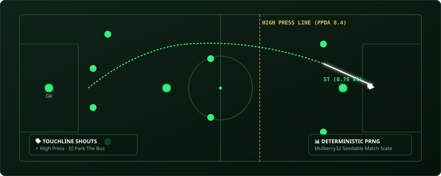

<p align="center">
  
</p>

<p align="center">
  <strong>The deterministic, zero-dependency football management simulator.</strong><br>
  <em>Pick the eleven. Set the system. Scream touchline shouts. Watch 22 tactical dots battle for 90 minutes of pure glory.</em>
</p>

<p align="center">
  <a href="https://touchline-xi-fawn.vercel.app/"></a>
</p>

<p align="center">
  
  
  
  
  
  
</p>

---

## ☕ Why Touchline XI?

> *"Football is simple. But the most difficult thing is to play simple football."* — **Johan Cruyff**  
> *"Football is 22 dots moving on a Canvas at 60 FPS while I yell at my laptop screen at 2 AM."* — **You, 5 minutes after opening this game.**

Tired of EA charging \$70 every autumn for updated rosters, loot boxes, and server lag?

**Touchline XI** is an open-source, deterministic tactical laboratory built as an independent football counterpart to [ShounaksHub/Cricket-Game](https://github.com/ShounaksHub/Cricket-Game). 

Zero npm installs. Zero build tools required to play. Just double-click the HTML file and deploy your tactical masterclass.

---

## 🏟️ The 6 Stadium Zones

Touchline XI features a **true multi-page stadium architecture** with instant tab transitions, URL hash routing, and zero scroll bleed:

<p align="center">
  
</p>

| Zone | Route | What Goes Down |
| :--- | :--- | :--- |
| **🏟️ Match Centre** | `#matchday` | **The Broadcast Arena.** Live 2D pitch radar with ball physics, in-match manager shouts, live commentary wire, cumulative xG graph, and scoreboard. |
| **📋 Squad Lab** | `#squad` | **The Gaffer's War Room.** Starting XI and bench swaps with real-time stamina gauges, formation pitch diagrams, and tactical sliders (*Low Block → Heavy Metal Press*). |
| **🏆 Tournament Cup** | `#tournament` | **Knockout Championship.** Battle through Quarter-Finals, Semi-Finals, and Final with Extra Time (90′–120′) and sudden-death penalty shootouts. |
| **✨ Dream Team Studio** | `#dreamteam` | **Fantasy Galácticos.** Draft any world legend or active superstar into your custom fantasy squad and test them against adaptive AI managers. |
| **🔍 Global Scouting** | `#scouting` | **Transfer Database.** Search and inspect 12,900+ footballers across 350+ clubs and nations with metallic FUT-style player cards, attribute radars, and bio inspections. |
| **📼 Replay Vault** | `#vault` | **The Archive.** Frame-by-frame scrubbable match tape recorder. Export or import full match JSON replays to prove your 94th-minute screamer happened. |

---

## 🧠 Tactical Depth & Pitch Mechanics

<p align="center">
  
</p>

### 🗣️ Touchline Shouts (What You Yell vs. What Happens)

You aren't just a spectator. In Touchline XI, clicking a tactical shout delivers live managerial instructions straight to the pitch:

| Manager Shout | What You Yell | In-Engine Simulation Effect |
| :--- | :--- | :--- |
| ⚡ **High Press** | *"DON'T LET THEM BREATHE!"* | Pressing intensity spikes to 88. Increases turnover recovery in final third by +35%, but drains player stamina fast. |
| 🧱 **Park The Bus** | *"EVERYONE BEHIND THE BALL!"* | Drops block depth to 15. Compacts defensive box coordinates, cuts opponent shot quality (xG) by -40%. |
| 🎯 **Shoot On Sight** | *"JUST SHOOT FROM THERE!"* | Increases long-range shot trigger probability by +65%. |
| 🔄 **Work Into Box** | *"WAIT FOR THE RUN, STOP HOOFING IT!"* | Demands patient passing in zone 14; yields fewer shots but higher individual chance xG (~0.45+). |
| 🔥 **Demand More** | *"WAKE UP, WE ARE LOSING AT HOME!"* | Manager speech boost: immediately lifts team tempo and grants a mid-match stamina second wind. |

---

## 🧬 Calibrated Football Science

Touchline XI does **not** generate random scores. Every frame runs on a **deterministic Mulberry32 PRNG engine**, calibrated against hundreds of thousands of top-tier European match minutes:

### 📊 500-Match Monte Carlo Simulation Benchmark

| Metric | Touchline XI Simulated Benchmark | Real-World Football Reference |
| :--- | :--- | :--- |
| **Total Matches** | `500` | Top 5 European leagues |
| **Average Goals / Game** | **2.91** | ~2.70 – 3.05 |
| **Average Shots / Game** | **20.83** | ~20.0 – 24.5 |
| **Shots on Target** | **8.83** | ~7.5 – 10.0 |
| **Corner Kicks** | **5.70** | ~5.0 – 6.5 |
| **Fouls Conceded** | **6.89** | ~6.5 – 9.0 |
| **Yellow Cards** | **1.29** | ~1.2 – 2.0 |
| **Red Cards** | **0.14** | ~0.10 – 0.18 |
| **Home Win %** | **41.2%** | ~40 – 45% *(True home advantage)* |
| **Draw %** | **24.6%** | ~23 – 27% |
| **Away Win %** | **34.2%** | ~30 – 35% |
| **Clean Sheet %** | **41.2%** | ~38 – 44% |

---

## ⌨️ Touchline Cheatsheet (Hotkeys)

Feel like a genuine manager working the technical area with keyboard controls:

| Key | Action |
| :---: | :--- |
| <kbd>Space</kbd> | **Play / Pause** simulation (or pause replay tape) |
| <kbd>→</kbd> or <kbd>S</kbd> | **Step Forward 1 Minute** of play |
| <kbd>F</kbd> | **Simulate Straight to Full Time (FT)** |
| <kbd>M</kbd> | **Toggle Stadium Sound FX** (Crowd roars, referee whistles) |
| <kbd>1</kbd> / <kbd>2</kbd> / <kbd>5</kbd> | **Playback Speed** (1× normal pace, 2× fast forward, 5× lightning sim) |

---

## 🚀 Instant Quickstart

### Option 1: Play in Browser (Zero Install)
👉 Click the live link: **[touchline-xi-fawn.vercel.app](https://touchline-xi-fawn.vercel.app/)**

### Option 2: 100% Offline Standalone
Double-click [`touchline-xi-standalone.html`](touchline-xi-standalone.html).  
No Wi-Fi needed. Play on airplanes, subways, or while pretending to work on a spreadsheet.

### Option 3: Local Dev Server (Node.js 20+)
No third-party packages to install. Zero dependencies.

```bash
# 1. Clone the repo
git clone https://github.com/ShounaksHub/touchline-xi.git
cd touchline-xi

# 2. Fire up the native static server
npm start

# 3. Run the full 24-test suite
npm test
```
Visit `http://localhost:4173` in your browser.

---

## 🏗️ Project Architecture

```
touchline-xi/
├── assets/
│   ├── touchline-banner.svg     # SVG Hero Banner
│   └── tactical-pitch.svg       # SVG Tactical Board Diagram
├── index.html                   # Standalone browser production entrypoint
├── index.template.html          # Clean multi-page development template
├── styles.css                   # Responsive dark emerald tactical design system
├── touchline-xi-standalone.html # Single-file offline bundle (1090 KiB)
├── src/
│   ├── app.js                   # Navigation router, manager UI, audio synthesizer, HUD
│   ├── engine.js                # Deterministic match engine, xG, penalties, stamina, cards
│   ├── pitch.js                 # 2D Canvas radar renderer, player ball animations
│   ├── tournament.js            # Knockout cup brackets, extra time, penalty shootouts
│   ├── sound.js                 # Web Audio API procedural whistles and crowd noise
│   └── data.js                  # 350+ clubs & nations, 12,900+ real footballers
├── tests/
│   ├── engine.test.mjs          # Core engine invariants and match rules
│   ├── statistical_audit.test.mjs # 500-match Monte Carlo simulation validator
│   ├── interaction_audit.test.mjs # Cross-team substitutions and tournament state
│   ├── check_dom_ids.mjs        # 122 DOM element sync check
│   ├── find_missing_css_classes.mjs # CSS stylesheet audit
│   └── verify_pages.mjs         # Headless Chrome CDP page router verifier
└── tools/
    ├── build-standalone.mjs     # Standalone packager & dist builder
    └── dev-server/server.mjs    # Zero-dependency local Node.js static server
```

---

## 🤝 Community & Credits

- Created with ❤️ by **[Shounak](https://github.com/ShounaksHub)**
- Sibling project: **[Cricket-Game](https://github.com/ShounaksHub/Cricket-Game)**
- License: **MIT** — Fork it, mod your local five-a-side pub team into it, or build your own football manager!
