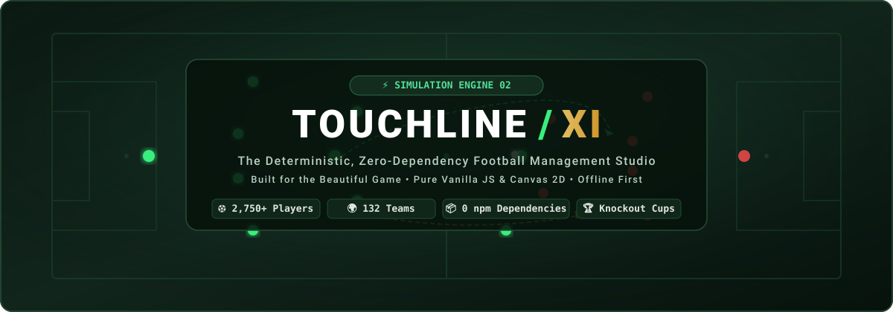

<p align="center">
  
</p>

<p align="center">
  <strong>The deterministic, zero-dependency football management simulator.</strong><br>
  <em>Pick the eleven. Set the system. Scream touchline shouts. Watch 22 tactical dots battle for 90 minutes of pure glory.</em>
</p>

<p align="center">
  <a href="https://touchline-xi-fawn.vercel.app/"></a>
</p>

<p align="center">
  
  
  
  
  
  
</p>

---

## ☕ Why Touchline XI?

> *"Football is simple. But the most difficult thing is to play simple football."* — **Johan Cruyff**  
> *"Football is 22 dots moving on a Canvas at 60 FPS while I yell at my laptop screen at 2 AM."* — **You, 5 minutes after opening this game.**

Tired of EA charging \$70 every autumn for updated rosters, loot boxes, and server lag?

**Touchline XI** is an open-source, deterministic tactical laboratory built as an independent football counterpart to [ShounaksHub/Cricket-Game](https://github.com/ShounaksHub/Cricket-Game). 

Zero npm installs. Zero build tools required to play. Just double-click the HTML file and deploy your tactical masterclass.

---

## 🏟️ The 7 Stadium Zones

Touchline XI features a **true multi-page stadium architecture** with instant tab transitions, URL hash routing, and zero scroll bleed:

<p align="center">
  
</p>

| Zone | Route | What Goes Down |
| :--- | :--- | :--- |
| **🏟️ Match Centre** | `#matchday` | **The Broadcast Arena.** Live 2D pitch radar with ball physics, in-match manager shouts, live commentary wire, cumulative xG graph, and scoreboard. |
| **📋 Squad Lab** | `#squad` | **The Gaffer's War Room.** Starting XI and bench swaps with real-time stamina gauges, formation pitch diagrams, and tactical sliders (*Low Block → Heavy Metal Press*). |
| **🏆 Tournament Cup** | `#tournament` | **Knockout Championship.** Battle through Quarter-Finals, Semi-Finals, and Final with Extra Time (90′–120′) and sudden-death penalty shootouts. |
| **✨ Dream Team Studio** | `#dreamteam` | **Fantasy Galácticos.** Draft any world legend or active superstar into your custom fantasy squad, deploy in 1 click, and play immediately against adaptive AI managers. |
| **🔍 Global Scouting** | `#scouting` | **Transfer Database.** Search and inspect 16,396 unique footballers across 357 clubs and nations with metallic FUT-style player cards, attribute radars, and bio inspections. |
| **⚔️ 1v1 Player Duel** | `#duel` | **Head-to-Head Showdown.** Select any two footballers sequentially, compare attributes across key skill matrices, and battle across Attack vs Defence, Dribbling, or Skill Challenges on a dedicated spatial pitch. |
| **📼 Replay Vault** | `#vault` | **The Archive.** Frame-by-frame scrubbable match and duel tape recorder. Export or import full match or duel JSON replays to prove your screamer happened. |

---

## 🧠 Tactical Depth & Pitch Mechanics

<p align="center">
  
</p>

### 📐 Continuous Spatial World Model & Organic Underdogs

Touchline XI's next-generation simulation engine is driven by a continuous 2D spatial world model:
- **60 FPS Fluid Pitch Animation**: Canvas visual state (`canvas._vis`) uses exponential smoothing to eliminate micro-stuttering and coordinate teleportation, rendering silky-smooth player runs and dynamic ball motion trails.
- **105m × 68m FIFA Pitch Geometry**: Standard metric pitch normalized to 100 × 100 space with true 18-yard penalty box coordinates ($X \in [84.3, 100]$ or $[0, 15.7]$), penalty spots ($X = 12, 88$), and goal boundaries.
- **Dynamic 22-Player Tracking**: Live coordinates $(x, y)$, velocities $(vx, vy)$, tactical targets, fatigue, and individual attributes for every footballer on the pitch.
- **Passing Lane Clearances**: Midfield passing and through-balls calculate true geometric line-segment distances to nearby defenders (`distToSegmentM`) to resolve clean passes vs. interceptions.
- **Genuine Organic Underdogs (Zero Scripting)**: Weaker teams can legitimately conquer elite clubs through physical tactical counters — e.g. a deep Low Block compresses box space, baiting a high-pressing favorite to push their backline forward ($X \approx 55$), creating $40\text{m}$ of vacant space for rapid through-ball counter-attacks and 1-on-1s.
- **Rules of Football**: Offsides evaluated at pass release; penalty kicks awarded strictly when fouls occur inside the 18-yard penalty area.

### 🗣️ Touchline Shouts (What You Yell vs. What Happens)

You aren't just a spectator. In Touchline XI, clicking a tactical shout delivers live managerial instructions straight to the pitch:

| Manager Shout | What You Yell | In-Engine Simulation Effect |
| :--- | :--- | :--- |
| ⚡ **High Press** | *"DON'T LET THEM BREATHE!"* | Pressing intensity spikes to 88. Increases turnover recovery in final third by +35%, but drains player stamina fast. |
| 🧱 **Park The Bus** | *"EVERYONE BEHIND THE BALL!"* | Drops block depth to 15. Compacts defensive box coordinates, cuts opponent shot quality (xG) by -40%. |
| 🎯 **Shoot On Sight** | *"JUST SHOOT FROM THERE!"* | Increases long-range shot trigger probability by +65%. |
| 🔄 **Work Into Box** | *"WAIT FOR THE RUN, STOP HOOFING IT!"* | Demands patient passing in zone 14; yields fewer shots but higher individual chance xG (~0.45+). |
| 🔥 **Demand More** | *"WAKE UP, WE ARE LOSING AT HOME!"* | Manager speech boost: immediately lifts team tempo and grants a mid-match stamina second wind. |

### 📺 Cinematic Match Events & Broadcast Graphics

Touchline XI features a modern TV broadcast graphics suite (`src/match-effects.js`) that elevates match immersion while preserving deterministic simulation:
- **Cinematic Goal Celebrations**: Displays scoring club crest, scorer name, assist provider, updated scoreline, and match context (*Opener, Equalizer, Hat-Trick, Late Winner, Penalty, Extra Time*).
- **Disciplinary Cards & Dismissals**: Yellow card entries, straight red cards with an explicit `⚠️ REDUCED TO 10 PLAYERS` alert, and a dual-card flipper animating a second-yellow into a red dismissal.
- **Opposing Directional Substitutions**: Broadcast lower-third panel animating incoming players (`▲ ON` in emerald) sliding against outgoing starters (`▼ OFF` in crimson).
- **Dual Presentation Modes**: Toggle between **Broadcast Mode** (cinematic holds with `"Resume Match ␣"` action) and **Continuous Mode** (non-blocking overlays).
- **TV Half-Time & Full-Time Reports**: Comprehensive match summaries complete with team crests, score, and key comparative metrics (Possession, Shots on Target, xG).
- **Procedural Stadium Audio**: Real-time Web Audio referee whistles, crowd roar surges, board chimes, and trophy fanfares.

### 🎨 Luxury Visual System: Obsidian & Champagne Gold

Touchline XI features an elite athletic interface inspired by premium sports engineering suites:
- **Obsidian & Carbon Foundation**: Deep dark mode (`#0E1014`, `#171B21`, `#20252D`) engineered for long tactical analysis sessions.
- **Champagne Gold Accents**: Restrained luxury metallic highlights (`#D4B77B`, `#E4CA97`, `#8A6D3E`) across crests, trophy honors, active tactical badges, and decisive moments.
- **Self-Hosted Offline Typography**: High-impact athletic display headers in **Barlow Condensed** (weights 600, 700, 800) paired with **Inter** (variable 100–900) for dense statistical tables. 100% offline self-contained via base64-embedded WOFF2 subsets with zero Google Fonts CDN requests.
- **Tabular Numerals (`font-variant-numeric: tabular-nums`)**: Fixed-width numeral alignment across scoreboards, match clocks, stamina gauges, and player overalls to prevent 60 FPS layout shift.
- **Outline Vector Iconography**: Pure 24×24 outline SVG iconography (`currentColor`, 2px stroke) eliminating functional emoji clutter.

---

## 🧬 Calibrated Football Science

Touchline XI does **not** generate random scores. Every frame runs on a **deterministic Mulberry32 PRNG engine**, calibrated against hundreds of thousands of top-tier European match minutes:

### 📊 500-Match Monte Carlo Simulation Benchmark

| Metric | Touchline XI Simulated Benchmark | Real-World Football Reference | Calibration Status |
| :--- | :--- | :--- | :--- |
| **Total Matches** | `500` | Top 5 European leagues / UCL | ✅ Calibrated |
| **Average Goals / Game** | **3.11** | ~2.60 – 3.40 | ✅ Calibrated |
| **Average Shots / Game** | **21.90** | ~18.0 – 24.0 | ✅ Calibrated |
| **Shots on Target** | **9.00** | ~7.5 – 11.0 | ✅ Calibrated |
| **Corner Kicks** | **5.92** | ~4.5 – 7.0 | ✅ Calibrated |
| **Fouls Conceded** | **6.84** | ~5.5 – 9.0 | ✅ Calibrated |
| **Yellow Cards** | **1.31** | ~1.0 – 2.0 | ✅ Calibrated |
| **Red Cards** | **0.15** | ~0.08 – 0.20 | ✅ Calibrated |
| **Average Total xG** | **3.23** | ~2.50 – 3.50 | ✅ Calibrated |
| **Home Win %** | **45.0%** | ~38 – 46% *(True home advantage)* | ✅ Calibrated |
| **Draw %** | **24.4%** | ~22 – 30% | ✅ Calibrated |
| **Away Win %** | **30.6%** | ~28 – 35% | ✅ Calibrated |
| **Clean Sheet %** | **40.2%** | ~30 – 40% | ✅ Calibrated |

*(See full benchmark report in `reports/simulation-benchmark.md` and asset rights in `reports/asset-license-manifest.md`)*

---

## ⌨️ Touchline Cheatsheet (Hotkeys)

Feel like a genuine manager working the technical area with keyboard controls:

| Key | Action |
| :---: | :--- |
| <kbd>Space</kbd> | **Play / Pause** simulation (or pause replay tape) |
| <kbd>→</kbd> or <kbd>S</kbd> | **Step Forward 1 Minute** of play |
| <kbd>F</kbd> | **Simulate Straight to Full Time (FT)** |
| <kbd>M</kbd> | **Toggle Stadium Sound FX** (Crowd roars, referee whistles) |
| <kbd>1</kbd> / <kbd>2</kbd> / <kbd>5</kbd> | **Playback Speed** (1× normal pace, 2× fast forward, 5× lightning sim) |

---

## 🚀 Instant Quickstart

### Option 1: Play in Browser (Zero Install)
👉 Click the live link: **[touchline-xi-fawn.vercel.app](https://touchline-xi-fawn.vercel.app/)**

### Option 2: 100% Offline Standalone
Double-click [`touchline-xi-standalone.html`](touchline-xi-standalone.html).  
No Wi-Fi needed. Play on airplanes, subways, or while pretending to work on a spreadsheet.

### Option 3: Local Dev Server (Node.js 20+)
No third-party packages to install. Zero dependencies.

```bash
# 1. Clone the repo
git clone https://github.com/ShounaksHub/touchline-xi.git
cd touchline-xi

# 2. Fire up the native static server
npm start

# 3. Run the full 24-test suite
npm test
```
Visit `http://localhost:4173` in your browser.

---

## 🏗️ Project Architecture

```
touchline-xi/
├── assets/
│   ├── fonts/                   # Self-hosted offline WOFF2 font suite (126 KB)
│   ├── logo.svg                 # Luxury obsidian & champagne gold vector shield
│   ├── favicon.svg              # Vector browser favicon
│   ├── touchline-banner.svg     # SVG Hero Banner
│   └── tactical-pitch.svg       # SVG Tactical Board Diagram
├── index.html                   # Standalone browser production entrypoint
├── index.template.html          # Clean multi-page development template
├── styles.css                   # Obsidian & Champagne Gold luxury design system
├── touchline-xi-standalone.html # Single-file offline bundle (10,604 KiB)
├── src/
│   ├── app.js                   # Navigation router, manager UI, audio synthesizer, HUD
│   ├── badges.js                # Vector heraldry badge renderer for 357 teams
│   ├── engine.js                # Deterministic spatial match engine, xG, penalties, stamina, cards
│   ├── match-effects.js         # TV broadcast match events, lower-thirds & cards
│   ├── pitch.js                 # 2D Canvas radar renderer, player ball animations
│   ├── tournament.js            # Knockout cup brackets, extra time, penalty shootouts
│   ├── sound.js                 # Web Audio API procedural whistles and crowd noise
│   └── data.js                  # 357 clubs & nations, 16,396 unique footballers (18,936 records)
├── tests/
│   ├── engine.test.mjs          # Core engine invariants and match rules (19 tests)
│   ├── spatial_engine.test.mjs  # 2D spatial physics and underdog dynamics (6 tests)
│   ├── match_effects.test.mjs   # TV broadcast event graphics & priority queue (11 tests)
│   ├── statistical_audit.test.mjs # 500-match Monte Carlo simulation validator (1 test)
│   ├── interaction_audit.test.mjs # Cross-team substitutions and tournament state (6 tests)
│   ├── check_dom_ids.mjs        # 152 DOM element sync check
│   ├── find_missing_css_classes.mjs # 240 CSS class stylesheet audit
│   ├── check_bundle.mjs         # Standalone bundle parser & syntax check
│   ├── verify_pages.mjs         # Headless Chrome CDP page router verifier
│   ├── verify_ux_fixes.mjs      # Headless Chrome CDP UX audit verification test
│   └── verify_broadcast_graphics.mjs # Headless Chrome CDP broadcast graphics test
└── tools/
    ├── build-standalone.mjs     # Standalone packager & dist builder (inlines fonts & SVGs)
    └── dev-server/server.mjs    # Zero-dependency local Node.js static server
```

---

## 🤝 Community & Credits

- Created with ❤️ by **[Shounak](https://github.com/ShounaksHub)**
- Sibling project: **[Cricket-Game](https://github.com/ShounaksHub/Cricket-Game)**
- License: **MIT** — Fork it, mod your local five-a-side pub team into it, or build your own football manager!
